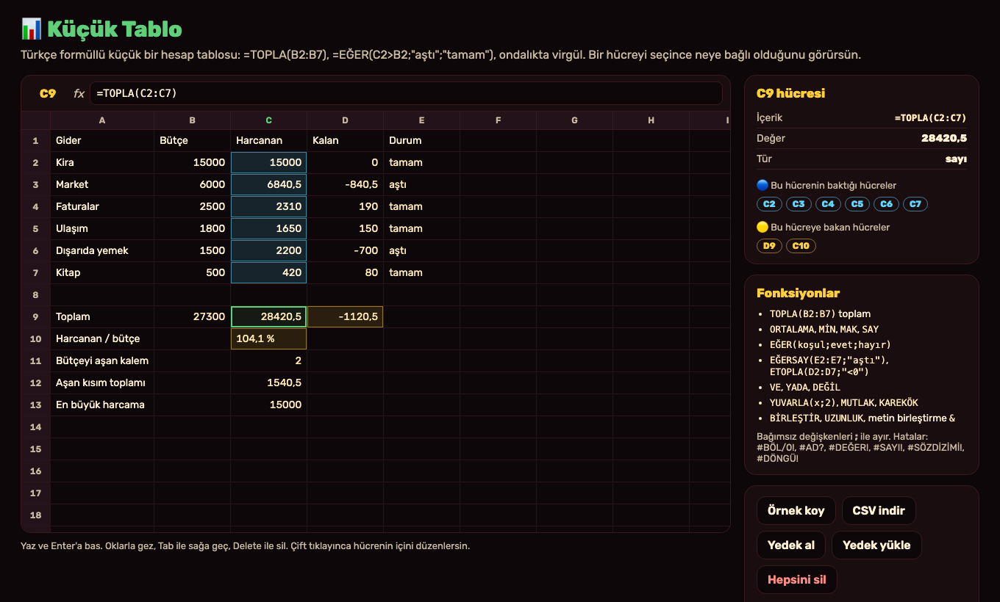
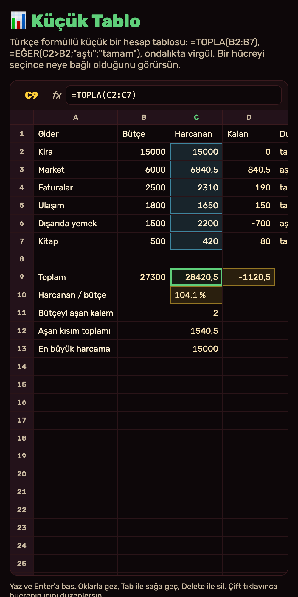

# 📊 Küçük Tablo

Aklıma bu geldi: her gün kullandığım hesap tablolarının içinde ne olduğunu merak ediyordum. Bir hücreye `=TOPLA(B2:B7)` yazınca formül nasıl okunuyor? Bir hücreyi değiştirince hangi hücreler hangi sırayla yeniden hesaplanıyor? Hücreler birbirine döngüyle bağlanınca ne oluyor? Ben bunları anlamak için sıfırdan, Türkçe formüllü küçük bir hesap tablosu yazdım. Hiçbir kütüphane kullanmadım.

## Ben nasıl kullanıyorum?

1. Klasörde `python3 -m http.server 8000` komutunu çalıştırıp tarayıcıda `http://localhost:8000` adresini açıyorum. (`?ornek` eklersem uydurma bir aylık ev bütçesi açılıyor.)
2. Bir hücreye tıklayıp yazmaya başlıyorum, Enter'a basıyorum.
   - Sayıları `12,5` gibi virgülle yazıyorum; `%15` ya da `1.250,50` da oluyor.
   - Formüller `=` ile başlıyor ve bağımsız değişkenleri `;` ile ayırıyorum: `=EĞER(C2>B2;"aştı";"tamam")`.
3. Oklarla geziyorum. Tab sağa geçiyor, Delete siliyor, çift tıklama hücrenin içini düzenliyor. Üstteki formül çubuğundan da düzenleyebiliyorum.
4. Bir hücreyi seçince sağda içeriği, değeri ve türü çıkıyor.
   - **Mavi** hücreler bu hücrenin baktığı hücreler, **sarı** hücreler bu hücreye bakan hücreler.
   - Etiketlere tıklayınca o hücreye gidiyorum.
5. **CSV indir** ile değerleri `;` ayraçlı bir dosya olarak alıyorum. **Yedek al** formüllerle birlikte JSON dosyası olarak saklıyor.

Her şey sadece kendi tarayıcımda duruyor.

## Ben içeride ne yaptım?

- `core.mjs` formül motoru, `app.mjs` sadece tablo ekranı.
- **Belirteçlere ayırma:** formülü sayı, metin, ad ve işaret parçalarına ayırıyorum. `1,5` bir sayı; `;` bağımsız değişken ayracı.
- **Ayrıştırıcı (özyinelemeli iniş):** her öncelik seviyesi için bir fonksiyon yazdım. Öncelik düşükten yükseğe şöyle:
  - karşılaştırma (`=`, `<>`, `<` …)
  - `&` (metin birleştirme)
  - `+` ve `-`
  - `*` ve `/`
  - `^`
  - `%`
  - tekli `-`

  Excel'deki gibi `-2^2` 4 çıkıyor, `2^3^2` 64 çıkıyor.
- Fonksiyon adlarını Türkçe büyük harfe çeviriyorum, böylece `eğer` de `EĞER` de oluyor.
- **Değerlendirme:** sayı, metin, mantık ve hata değerleri var. Sayı gibi görünen metin hesapta sayıya dönüyor. Hata hücreden hücreye yayılıyor. `EĞER` sadece seçtiği dalı hesaplıyor, `=EĞER(DOĞRU;1;1/0)` hata vermiyor.
- **Fonksiyonlar:** TOPLA, ORTALAMA, MİN, MAK, SAY, EĞER, EĞERSAY, ETOPLA, VE, YADA, DEĞİL, YUVARLA, MUTLAK, KAREKÖK, BİRLEŞTİR, UZUNLUK. EĞERSAY ve ETOPLA `">1000"`, `"<>aştı"` gibi ölçütler anlıyor.
- **Yeniden hesaplama sırası:** her formülün baktığı hücrelerden bir bağımlılık grafiği kuruyorum. **Tarjan'ın güçlü bağlı bileşenler algoritmasıyla** hem doğru sırayı (önce bakılan hücreler) hem de döngüleri tek seferde buluyorum. Döngüdeki hücreler ve onlara bakanlar `#DÖNGÜ!` gösteriyor. Algoritmayı özyinelemesiz yazdım, uzun zincirlerde yığın taşmasın diye.
- **Sayıları yazarken** kayan nokta gürültüsünü temizliyorum: `=0,1+0,2` ekranda `0,3` çıkıyor, `0,30000000000000004` değil.
- **Hatalar:** #BÖL/0!, #AD?, #DEĞER!, #SAYI!, #SÖZDİZİMİ!, #DÖNGÜ!. Fareyle üstüne gelince ne demek olduğu yazıyor.

## Ben neyi sınadım?

Ben `node test.mjs` komutunu çalıştırdım. **96 kontrol** geçti.

- **1000 rastgele aritmetik formülü** (iç içe parantez, dört işlem) JavaScript'in kendi hesabıyla karşılaştırdım. Hepsi aynı çıktı.
- Öncelik kuralları: `1+2*3 = 7`, `-2^2 = 4`, `2^3^2 = 64`, `50% = 0,5`.
- Sütun adlarını 2000 sütun boyunca ileri geri çevirdim (A … Z, AA … ZZ …), hepsi tuttu.
- Döngüler: `A1→B1→C1→A1` ve kendine bakan `E1` yakalanıyor. Onlara bakan `D1` de `#DÖNGÜ!` oluyor, döngüyle ilgisi olmayan hücreler etkilenmiyor.
- **2000 hücrelik bir zincir** (her hücre bir öncekine +1) yığın taşmadan hesaplanıyor.
- Hücrelerin yazılış sırası önemli değil: `A1=A2+1`, `A2=A3*2`, `A3=5` → A1 = 11.
- Örnek bütçede toplam bütçe **27.300 TL**, harcanan **28.420,50 TL**. Bütçenin **%104,1**'i harcanmış, **2 kalem** bütçeyi aşmış, aşan kısım **1.540,50 TL**.
- CSV'de `;` ve tırnak içeren hücreler doğru kaçırılıyor. Bozuk yedek dosyası reddediliyor.

Testleri yazarken önceden düşünüp önlem aldığım bir tuzak vardı: Türkçe büyük harf. Fonksiyon adlarını Türkçe kurallarla büyütüyorum, ama aynı kural hücre adreslerine uygulansaydı `i3` küçük harfle yazılınca `İ3` olacak ve hiçbir sütuna denk gelmeyecekti. Hücre adreslerini ayrı, sadece İngilizce harflerle büyüttüm ve bunu bir testle kilitledim.

Ben uygulamayı tarayıcıda da açtım. Denediklerim:

- Bir hücreye yazınca ona bağlı hücreler güncellendi. Kira'yı 16.000 yapınca Kalan −1000 ve Durum "aştı" oldu, toplam değişti.
- Formül çubuğundan iki hücreyi birbirine bağlayınca ikisi de `#DÖNGÜ!` oldu ve sağda uyarı çıktı.
- Silme, oklarla gezme, Escape ile vazgeçme ve etiketlere tıklayıp hücreye gitme çalıştı.
- `` gibi bir yazı hücrede düz metin olarak göründü, çalışmadı.
- Telefon boyutunda (375 piksel) sayfa yana taşmadı, tablo kendi içinde kayıyor.

Benim sınırlarım var:

- Tablo 12 sütun × 40 satır.
- Formülü kopyalayınca adresler kaymıyor, `$A$1` gibi sabit adres yok.
- Tarih, biçimlendirme, sıralama ve grafik yok.
- Her değişiklikte bütün tabloyu yeniden hesaplıyorum; bu boyutta hızlı ama büyük tablolar için sadece değişen kısmı hesaplamak gerekir.
- Telefonda hücreyi düzenlemek için çift dokunmak ya da formül çubuğunu kullanmak gerekiyor.

## Ben bunları nereden öğrendim?

- Özyinelemeli iniş ayrıştırıcı ve öncelik seviyeleri: Robert Nystrom, *Crafting Interpreters* (2021).
- Güçlü bağlı bileşenler: Robert Tarjan, "Depth-First Search and Linear Graph Algorithms", *SIAM Journal on Computing* 1(2), 1972.
- Operatör önceliği ve hata adları: Excel ve LibreOffice Calc'ın Türkçe sürümlerindeki davranış (`-2^2 = 4`, `;` ayracı, `#BÖL/0!`).

## Ben bugünün kaynaklarına nasıl baktım?

Ben 18 Kasım 2026 saat 09.01 Türkiye vaktinde [GitHub Trending günlük listesine](https://github.com/trending?since=daily) baktım. Gördüğüm 15 repo arasında ilk sıradaki repo "bugün 1.005 yıldız" almıştı. Aynı listede [dream-num/univer](https://github.com/dream-num/univer) vardı; tarayıcıda çalışan bir ofis ve hesap tablosu kütüphanesi, "bugün 1.774 yıldız" yazıyordu. Benim fikrim buradan çıktı. Ben onların kodunu kopyalamadım, kendi motorumu sıfırdan yazdım. Bu liste bütün GitHub'ın kesin sıralaması değildir.

Ben aynı anda [Trends24 dünya listesinde](https://trends24.in/) `毒うさぎ` başlığını ilk sırada gördüm. Projeme zorla eklemedim. Bu liste üçüncü taraf bir anlık görünümdür; bütün günün kesin en çok konuşulan konusu demem.

Ben [Reddit r/popular Top/Today listesine](https://www.reddit.com/r/popular/top/?t=day) de bakmak istedim ama bugün ulaşamadım. 09.01 ile 09.10 arasında birkaç kez denedim; Reddit "çok fazla istek" (429), "yasak" (403) ve boş liste döndürdü. Bu yüzden bugün Reddit'in ilk sırasını yazamıyorum ve fikri ondan çıkarmadım.

Ben bu projeyi MIT lisansı ile paylaşıyorum.
